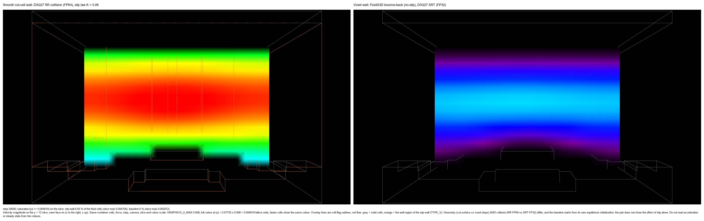

# Volumetric slip wall on terrain (D3Q27)

FluidX3D-API adds an opt-in wall boundary for a static triangulated terrain: the wall cuts the lattice cells (cut-cell
volumes, not voxel steps) and applies a sampled linear slip law. This page tells you how to build it, how to use it,
what the engine supports, and what it does not support.

> **Status (2026-11-10):** experimental, version 1. The model is qualified against an FP64 reference on an inclined channel
> and on one terrain fixture. The engine (FP64 arithmetic, FP32 storage) passes its acceptance on both: the channel for
> 65536 steps and the terrain fixture M3 for 2000 steps (see Validation). This qualifies the tested channel and terrain
> contract, not general terrain accuracy. The engine of this product passed its core acceptance
> (V1_PRODUCT_CORE_ACCEPTANCE_2026-11-10.md), and the ready example passed its checks: equivalence with the acceptance
> driver, finite outputs, the visual pair and one cost measurement (see Validation and Example results).
>
> **V2 (2026-11-11), opt-in:** a static Smagorinsky subgrid rate (`VOLUMETRIC_WALL_SGS`), a facetwise rough wall law
> (`VOLUMETRIC_WALL_ROUGH`), an open x axis with a hard or relaxed inlet and a characteristic outlet (`VOLUMETRIC_WALL_OPEN_X`), and an
> actual-hill example. See "V2: SGS, rough wall, open x and the hill example". **Hill flow status (2026-11-11): the extended-hill run PASSED its registered gates (task 129), and the scientist accepted it for ONE declared regime:** the 160 x 64 x 25 box, rest start,
> length-scaled inlet startup (K_u = 1/1580), open x with an outflow-only outlet, 16000 updates, nu 0.0006, U 0.05, with the SGS, rough wall, T119 and SRD options.
> Earlier runs did not pass, and they are the reason for the declared startup and the extended box: the uniform start (positivity at update 1, HF-01); the 80-wide box
> (outlet sign check at updates 110 and 5560, the wake reached the outlet); the first run on the 160-wide box with the 780-update ramp (density screen at update 625).
> **Limits:** this is a bounded validation of one numerical demonstration. It is not domain independence, not an atmospheric prediction, and not a statement about any other terrain, box or inlet.
> The outlet is outflow-only: a wake that reaches it can end a run with exit code 1 (in the accepted run the wake front was at least 34 cells upstream of the outlet at each of the saved checkpoints that were examined, 780 to 16000; this was observed at those checkpoints, not continuously).
> Record: research tree, `research/wall_model/v2/hill_demo/` (the task 125 to 129 protocols and results). The demo targets reproduced the final raw state of the accepted run byte for byte.
> **The no-slip baseline is a different setup (voxel bounce-back, FP32 SRT, fixed-equilibrium inlet at the full speed), not an isolated slip-only comparison.**
> The hill launch recipe below is the recipe of the accepted run.

## What the feature does

| Part | What it does |
|---|---|
| Geometry | A height-field terrain (triangles) in a box, periodic in x and y, with a flat slip lid at the top. Each fluid cell has its fluid volume; each wall facet has its own normal and area. |
| Collision | Recursive regularized (RR) D3Q27 collision with the full force term in **every** cell, in FP64 arithmetic. |
| Wall | The fluid that streams into a facet returns from it. The return has an even part at a wall-extrapolated state, a friction part, and one mass correction per facet that keeps the mass of the facet. |
| Slip law | A linear slip law at the sampled velocity: the wall traction ON THE FLUID is the vector `-rho * beta * u_t`, with `beta = K / 3` (lattice units); its magnitude is `rho * beta * |u_t|`. `u_t` is the tangential fluid velocity sampled half a cell from the facet. `K = 0` is a free-slip wall. |
| Transfer between facets | Fluid that leaves one facet and reaches another facet within one step is held as a pending amount and arrives one step later. The total of fluid plus pending mass is conserved. |
| Storage | Populations in FP32 (FluidX3D's shifted storage `g = f - w`); pending amounts and all wall arithmetic in FP64. |

In V1 the slip law is a prescribed linear coefficient: not a rough-wall or log-law closure, and no subgrid model. V2 adds
both as opt-in macros (see the V2 section). The feature makes no claim for atmospheric boundary layers, turbulence
prediction or stratification.

## How to build

The feature is a compile-time extension. Without it, FluidX3D does not change.

| Macro | Meaning |
|---|---|
| `VOLUMETRIC_WALL` | The native wall. |
| `VOLUMETRIC_WALL_RR27` | The qualified D3Q27 revision described on this page. Requires `D3Q27` and `VOLUMETRIC_WALL_FP64_COLLISION`. |
| `VOLUMETRIC_WALL_FP64_COLLISION` | FP64 collision arithmetic in the ordinary cells. |
| `VOLUME_FORCE` | A uniform, constant body force, the only supported forcing type. Zero force and a fluid at rest are supported. |

CMake: `add_fluidx3d_example(NAME <name> EXTENSIONS D3Q27 VOLUMETRIC_WALL VOLUMETRIC_WALL_FP64_COLLISION VOLUMETRIC_WALL_RR27 VOLUME_FORCE)`.

The build refuses (compile error) `VOLUMETRIC_WALL_RR27` without `D3Q27` or without `VOLUMETRIC_WALL_FP64_COLLISION`, and
with `SUBGRID`, `FP16S`, `FP16C`, `FORCE_FIELD`, `LEVEL_FORCING`, `TEMPERATURE`, `MOISTURE`, `SCALAR_FV`, `SURFACE`,
`PARTICLES`, `MOVING_BOUNDARIES` or `EQUILIBRIUM_BOUNDARIES`.

## How to use it

1. Get a container (`.vwnat` file) of the geometry. The container holds the cells, the cut volumes, the facets, the
   transfer maps, the friction rows, the gradient map, the scalars (`nu`, `omega`, `K`) and the initial populations and
   pending amounts. Make it with the offline builder (Python 3.10 or newer, numpy, scipy):

       python scripts/slip_wall/terrain_container.py --heights HEIGHTS.csv --z-top 16 --nu 0.1 --friction 0.06 --out terrain.vwnat

   `HEIGHTS.csv` holds Ny lines of Nx node heights (lattice units), periodic in x and y; the lid is at `--z-top`. The builder
   refuses a terrain with a slope of 1 or more, a lid clearance below 2 cells or a column that is not connected. The
   container starts at rest.

   The builder uses the heights exactly as given; it never rounds or moves them. A node height a tiny distance from an
   integer (a cell face), but not equal to it, can make a fluid sliver thinner than the binary64 clipping keeps (its
   vertex-on-plane tolerance is about 1e-12). The builder then refuses the cell, and the message names the node heights and
   their distances to the faces. Not every near-integer height is refused; whether a sliver is lost depends on the cell. If
   it happens, round or offset the heights yourself and record that change. Analytic terrain is the usual case: for example
   3.5 + cos(2 pi i/24) cos(2 pi j/24) gives 2.9999999999999996 where the exact value is 3.

   The example input `examples/volumetric_wall/L24_heights_r12.csv` is that analytic terrain with the heights rounded to
   12 decimals before the build (largest change 4.8e-13 lattice units); the rounding is part of the example's declared
   input, not of the builder. The ready container of this input is shipped; see "Run the example" below.

   The builder checks the map identities of every container with the native definitions and tolerance before it writes
   the file. When one fails, it writes `OUT.rejected.json` (the worst states) and no container, and exits with code 3.
2. Make an `LBM` of the container's box size with the container's viscosity and the force:
   `LBM lbm(Nx, Ny, Nz, nu, fx, fy, fz);`
3. Mark every cell outside the container's fluid cells `TYPE_S`.
4. Attach the wall before the first `run()`: `lbm.set_volumetric_wall("<file>.vwnat");`
5. Run: `lbm.run(steps);`

`examples/volumetric_wall` shows these steps. Its inputs are environment variables: `VOLUMETRIC_WALL_CONTAINER`,
`VOLUMETRIC_WALL_STEPS`, `VOLUMETRIC_WALL_FORCE` (`fx,fy,fz`), `VOLUMETRIC_WALL_OUT` (a folder for the fields; the wall build
also writes the raw state) and, in the visual targets, `VOLUMETRIC_WALL_FRAMES` (ascending steps for a frame). Its targets:

| Target | What it is |
|---|---|
| `volumetric_wall_rr27` | The slip wall described on this page (D3Q27, RR27), without graphics. |
| `volumetric_wall_noslip` | The baseline: the same container cells as plain voxels with FluidX3D's bounce-back and its FP32 SRT collision. Both the geometry (voxel steps instead of the cut surface) and the collision differ from the wall build, so a comparison shows the feature against the established baseline, not slip alone. |
| `volumetric_wall_rr27_visual`, `volumetric_wall_noslip_visual` | The same two builds with graphics: frames at the given steps with one fixed view (velocity on the middle y slice seen face-on, fixed camera, fixed colour scale). |
| `volumetric_wall`, `volumetric_wall_update_fields` | The earlier D3Q19 wall (kept for its earlier results). |

### Run the example

The commands are for PowerShell on Windows, from the root of a checkout. The build uses the `tools` submodule
(cmake-build-scripts). Initialize it once with `git submodule update --init tools`.

1. Configure and build the wall, the baseline and the container checker:

       tools\configure.bat Release Ninja -- -DFLUIDX3D_EXPERIMENTAL_VOLUMETRIC_WALL=ON
       tools\build.bat volumetric_wall_rr27 Release
       tools\build.bat volumetric_wall_noslip Release
       tools\build.bat volumetric_wall_native_check Release

   The executables are in `bin`. For the frames, build `volumetric_wall_rr27_visual` and `volumetric_wall_noslip_visual`.
2. Use the ready container `examples/volumetric_wall/L24_r12_d3q27.vwnat` (SHA-256 9af23bba..., 20.6 MB; box 24 x 24 x 16,
   7536 fluid cells, 1920 facets; `nu = 0.1`, `K = 0.06`, at rest). Its build record is
   `examples/volumetric_wall/L24_r12_d3q27.vwnat.json`, its provenance `scripts/slip_wall/PROVENANCE.md`.

   Optional, to make it again from the example input (CPU only; the recorded build took 307 s). The recorded build used
   Python 3.10.11, numpy 2.2.6 and scipy 1.15.3; byte identity of a rebuild with the shipped file is not claimed, so check
   the result with step 3. The builder refuses a container whose map identities fail and then writes
   `L24.vwnat.rejected.json` instead:

       python scripts/slip_wall/terrain_container.py --heights examples/volumetric_wall/L24_heights_r12.csv --velocities D3Q27 --z-top 16 --nu 0.1 --friction 0.06 --out L24.vwnat

3. Check the container (no GPU). The checker writes its cell lists with the given prefix and prints `PASS`:

       bin\volumetric_wall_native_check.exe examples\volumetric_wall\L24_r12_d3q27.vwnat L24_lists

4. Run the slip wall, then the baseline, on the same container and force:

       $env:VOLUMETRIC_WALL_CONTAINER = "examples\volumetric_wall\L24_r12_d3q27.vwnat"
       $env:VOLUMETRIC_WALL_STEPS = "20000"
       $env:VOLUMETRIC_WALL_FORCE = "0x1.2c1eb6p-17,0x1.2c1eb6p-18,0"
       New-Item -ItemType Directory -Force out_rr27, out_noslip
       $env:VOLUMETRIC_WALL_OUT = "out_rr27";   bin\volumetric_wall_rr27.exe
       $env:VOLUMETRIC_WALL_OUT = "out_noslip"; bin\volumetric_wall_noslip.exe

   Each output folder gets `rho.f32`, `u.f32` (the fields) and `meta.txt`; only the wall build also writes the raw state
   (`fi.f32`, `pending.f64`). For the frames, also set
   `$env:VOLUMETRIC_WALL_FRAMES` (for example `"5000,10000,20000"`) and run the two `_visual` executables.

The two images do not show slip alone. The left build is the smooth cut-cell D3Q27 RR wall with the slip law; the right
build is FluidX3D's voxel bounce-back (no-slip) with the SRT collision. Label them so.

**Units.** All values are lattice units. `K` is a container scalar; the wall traction on the fluid is `-rho * (K / 3) * u_t`
(the force on the wall is the opposite vector). In SI units, `beta_SI = (K / 3) * dx / dt`. The force density is momentum per volume per step. The velocity the fields hold is
the physical velocity `(j + F/2) / rho`.

**Enable and disable.** The feature is on only in a build with the macros above and only after `set_volumetric_wall()`.
A `VOLUMETRIC_WALL_RR27` build refuses `run()` without an attached wall, because its collision differs from the
baseline. To compare with the baseline, build the same setup without the macros. Switching needs a restart; there is no
live switching.

**Restart.** The state is the raw populations (`volumetric_wall_read_fi`), the pending amounts
(`volumetric_wall_read_pending`) and the time step `t`. To restart, attach the same container, call `run(0)`, write the
populations and the pending amounts back (`volumetric_wall_write_fi`, `volumetric_wall_write_pending`) and set `t`
(`volumetric_wall_set_time_step`). Never reset the pending amounts to zero.

## V2: SGS, rough wall, open x and the hill example

Each V2 part is a compile-time macro on top of `VOLUMETRIC_WALL_RR27`. Without the macro the code is the V1 code.

| Macro | What it does | Input |
|---|---|---|
| `VOLUMETRIC_WALL_SGS` | A static Smagorinsky rate in the RR collision of every cell. `SUBGRID` stays refused. | `LBM::set_volumetric_wall_sgs(k)` before the attachment; example: `VOLUMETRIC_WALL_SGS_K`. `k = 0` is the V1 rate. The qualified value is `0x1.8746d2p-1`. |
| `VOLUMETRIC_WALL_ROUGH` | A facetwise rough law `K_a = K0_a + 3 C_a |u_s,a|`, with `C = (0.4 / ln(0.5 / z0))^2` (sample distance 0.5). The lid stays free-slip. | The container sections `facet_friction` and `facet_kind`: builder option `--rough-z0 Z0` (and `--rough-K0`). A build without the macro refuses a container with these sections. |
| `VOLUMETRIC_WALL_OPEN_X` | An open x axis. The cells at `x = 0` (inlet) and `x = Nx - 1` (outlet) hold the equilibrium of an FP64 boundary state, which a characteristic (LODI) update advances. Hard or relaxed inlet; outlet relaxation `K_p = sigma (1 - Ma^2) c / L_x`. y stays periodic. | `LBM::set_volumetric_wall_open_x(VolumetricWallOpenX)` before the attachment; example: `VOLUMETRIC_WALL_OPEN=x` and the `VOLUMETRIC_WALL_INLET_*` and `_OUTLET_*` inputs (`examples/volumetric_wall/main.cpp`). |

What open x supports and refuses:

- Supported: one uniform inlet velocity with `0 < u_x < c` (`c = 1/sqrt(3)`), positive subsonic outflow, zero force.
- The length `L_x` of `K_p` is the cut length `Nx - 2` by default (the interior between the two boundary planes). For the
  80-wide hill it is 78; the box length is 80. The input `VOLUMETRIC_WALL_OUTLET_LENGTH` is not forced to `Nx - 2`: the extended 160-wide hill sets it to 78 on purpose, as a fixed relaxation reference length, so that `K_p` keeps its value.
- Refused at setup: an inlet with `u_x <= 0` or `u_x >= c`, a nonzero force, the open input in a closed build, an open build
  without the open input.
- Refused at run time (refusal 7.6, on the current and on the new boundary state): backflow at the outlet, inflow with the
  wrong sign, `|u_n| >= c`, `rho <= 0`, a value that is not finite. The example then stops with exit code 1; the run is
  invalid.
- Not supported: backflow, forcing with the open axis, an inlet profile, more than one domain, open y or z.

### The actual-hill example

| Item | Value |
|---|---|
| Terrain | `resources/hill.stl` (4 x 4 km, 702 m high) on a 64 x 64 node grid, 62.5 m per cell, with 8 flat apron columns at each x end: `examples/volumetric_wall/hill_64_apron8_heights.csv` (80 x 64 nodes, SHA-256 d60b6677...). The height in cells is `1 + h / 62.5`, rounded to 2^-10 cell (largest change 3.1 cm). Lattice x = STL +y (the wind direction of `examples/hill`); lattice y = -STL x. The highest node is 12.10 cells (694 m; the 62.5 m sampling lowers the 702 m peak). |
| Box | 80 x 64 x 24 (`--z-top 24`), free-slip lid; the extended hill adds 80 flat columns downstream (160 x 64 x 25, see below). Slopes up to 3.35 (73 degrees); 356 triangles are steeper than 3/2. |
| Parameters | `nu = 0.0006`, inlet `U = 0.05` (relaxed ramp from rest in the accepted run), outlet `sigma = 0.58`, `F = 0`, SGS `k = 0x1.8746d2p-1`, rough `z0 = 0.01563151457179204` (`C = 0.013324`). |
| Meaning | A reduced-Re numerical demonstration on a hill (`Re = U H / nu`, about 930 with the hill height in cells). It is not air at 10 km/h over 702 m, and not a validated prediction of atmospheric turbulence. The terrain is static and neutral (no heat). |

**Steep terrain.** By default the builder refuses slopes of 1 or more (R11). `--allow-steep` skips only that check (R10 and R1
stay) and records `"allow_steep": true` in the build report. Wall-return accuracy on facets steeper than 45 degrees is not
qualified. The steep geometry checks S8 and S8X (S8X up to slope 3.75) qualify the builder's geometry on their own bounded
inputs only. They are not a guarantee for every terrain with such slopes; each container still passes the builder's map
identity gate.

**Setup cost.** The container build runs on the CPU in Python. Every piece volume is exact (integer determinants, one
rounding), and `--workers N` runs the producer and donor passes on N processes; the container is the same, byte for byte, as
with one process (the worker count is only in the build report). Each worker holds its own copy of the cell geometry, so
the memory grows with N. The registered build of this input with the final builder and 20 workers took 603.4 s, with a peak of
15.7 GB (the sum over the process tree; record V2-HB-05, research tree). It is not a speed comparison with the earlier
builder: the arithmetic changed as well. The container is not shipped. Build it once:

    python scripts/slip_wall/terrain_container.py --heights examples/volumetric_wall/hill_64_apron8_heights.csv --z-top 24 --nu 0.0006 --friction 0 --rough-z0 "0.01563151457179204" --allow-steep --name hill --workers 20 --out hill_d3q27.vwnat

`--initial-velocity 0.05,0,0` (an option of the builder) would write the uniform start `f0 = feq3(1, (0.05, 0, 0))` in every cell. That start is the registered hill flow test HF-01, which did NOT PASS (see the status at the top): with
this start, a population became negative at update 1. The recipe below does not use it: its container starts at rest and the inlet ramps up. The example takes its start from the container in both modes.

The example does NOT check that every population stays positive or that the density stays inside 5 % of rho_inf. Its run-time checks are the open-boundary refusals 7.6 and the engine's invalid
wall-state and clamp counts at the end of `run()`. The commands below are the recipe of the accepted run (see the status at the top for its scope).

When a map identity fails, the builder writes `hill_d3q27.vwnat.rejected.json`, no container, and exits with code 3.

**The extended hill: the recipe of the accepted run (see the status at the top for its scope).** The order of the commands below is: geometry container, hill tables (the final container), configure and build, environment, run. Each command uses the file the previous one wrote: `hill_ext_d3q27.vwnat`, then `prep_hill\hill_final.vwnat`, then the output folders `out_hill_wall` and `out_hill_noslip`. The outlet of the 80-wide box was only 12 cells (1.1 hill heights) behind the last
raised terrain column, and the wake reached it. The extension keeps the hill, the resolution, the inlet, the viscosity, the roughness and the wall, and appends 80 flat columns
(height exactly 1) at the downstream end: `examples/volumetric_wall/hill_64_apron8_ext80_heights.csv` (160 x 64 nodes, SHA-256 8fb6d1fd...), box 160 x 64 x 25, 92 cells (8.28 hill heights, the
hill height being 11.1045 cells above the ground plane) between the last raised column and the outlet. This is one extension; it does not show that the result is independent of the domain.

Preparation of the container (rest start, no `--initial-velocity`). The registered container was built with the research-tree driver and the parallel builder
(`ports/20261112_v2_geom_par`, `builder3d.py` SHA-256 58cff4cd..., `terrain_container.py` 4f6d9ad9...). The shipped builder below (`terrain_container.py` SHA-256 8ae24321..., with the `--allow-steep` option instead of the driver)
was run independently from a clean export with the quoted roughness below: it reproduced the registered geometry container byte for byte (SHA-256 a0a1d18c...). A run with the unquoted roughness differed only in provenance and in 23244 terrain
friction coefficients (see the note after the command).

    python scripts/slip_wall/terrain_container.py --heights examples/volumetric_wall/hill_64_apron8_ext80_heights.csv --z-top 24 --nu 0.0006 --friction 0 --rough-z0 "0.01563151457179204" --allow-steep --name hill --workers 20 --out hill_ext_d3q27.vwnat

Write the roughness as a quoted string, as shown. PowerShell turns an unquoted `0.01563151457179204` into the double `0.015631514571792` (15 significant digits), which changes the 23244 terrain friction
coefficients by up to 2.3e-17; the quoted string keeps all 17 digits. `--name hill` is the name of the terrain in the container, and the builder does not append `.vwnat`: give the full output file name.

The registered geometry container `hill_d3q27.vwnat` has SHA-256 a0a1d18c1745c5c4d5e7d498a9817b2494ba4f62320020d94b136d8ecb2f3792 (230849 cells, 33484 facets, 324472 rows). The two
sections `t119_gdelta`, `t119_wmoment` (the whole-prism correction) and the 18 sections `t121_*` (the state redistribution) are added by `scripts/slip_wall/hill_tables/prepare_hill_container.py`. It runs the
qualified tools of the research tree, which are shipped verbatim in `scripts/slip_wall/hill_tables/tree/` (22 files, listed with their sha256 in `MANIFEST.sha256`), in four stages with explicit inputs; it needs
Python with numpy and scipy, and the companion extraction uses 20 worker processes. No algorithm is changed (see the header of the script for the few pinned constants it replaces in a copy).

    python scripts/slip_wall/hill_tables/prepare_hill_container.py --heights examples/volumetric_wall/hill_64_apron8_ext80_heights.csv --geometry hill_ext_d3q27.vwnat --workdir prep_hill --workers 20

The final container is `prep_hill/hill_final.vwnat`; the registered one has SHA-256 2acd5121ddd696101aa78c4e65d628c35661d9adf539877e016521d01520835a (the script reports whether yours equals it). The wall demo targets
(`volumetric_wall_rr27_sgs_rough_open_visual` and `_live`) are built with `VOLUMETRIC_WALL_T119` and `VOLUMETRIC_WALL_SRD`, and refuse any container without these sections.

    tools\configure.bat Release Ninja -- -DFLUIDX3D_EXPERIMENTAL_VOLUMETRIC_WALL=ON
    tools\build.bat volumetric_wall_rr27_sgs_rough_open_visual Release
    tools\build.bat volumetric_wall_noslip_open_visual Release

The `_visual` targets write frames (GRAPHICS). The `_live` targets (`volumetric_wall_rr27_sgs_rough_open_live`, `volumetric_wall_noslip_open_live`) open a window (INTERACTIVE_GRAPHICS; press P to
start). Both modes read the same container and use the same terrain cells, inflow speed, viscosity, camera and colour scale (`GRAPHICS_U_MAX 0.14`: full colour at |u| = 0.081).
`VOLUMETRIC_WALL_VIEW=hill` draws the terrain, velocity-coloured streamlines and the mode label. `VOLUMETRIC_WALL_VIEW_CENTER_X=40` centres the camera on the hill (the middle of the 80 columns the hill
occupies), so the downstream part does not dominate the picture. The camera is a free camera inside the box below the lid, at the middle of the box width, 0.6 box widths upstream of the view centre and at 86 % of the box height. It looks along the flow (+x), 24 degrees down, with a field of view of 84 degrees, so the whole raised hill, the approach and the wake are in the picture. The streamlines are drawn at a sparser seed density (`GRAPHICS_STREAMLINE_SPARSE 10u`), and the three label lines have a plain background. Both modes use the same function and the same settings.

The V2 wall (all values explicit; the startup is K_u = 1/1580, NOT the 1/780 of the 80-wide box):

    $env:VOLUMETRIC_WALL_CONTAINER = "prep_hill\hill_final.vwnat"
    $env:VOLUMETRIC_WALL_STEPS = "16000"
    $env:VOLUMETRIC_WALL_SGS_K = "0x1.8746d2p-1"
    $env:VOLUMETRIC_WALL_OPEN = "x"
    $env:VOLUMETRIC_WALL_INLET_U = "0.05,0,0"
    $env:VOLUMETRIC_WALL_INLET_MODE = "relaxed,0x1.4bd3edda68fe1p-11"
    $env:VOLUMETRIC_WALL_OUTLET_SIGMA = "0x1.28f5c28f5c28fp-1"
    $env:VOLUMETRIC_WALL_OUTLET_MACH = "0x1.62b9586ad0a21p-4"
    $env:VOLUMETRIC_WALL_OUTLET_LENGTH = "0x1.38p+6"
    $env:VOLUMETRIC_WALL_OUTLET_RHO_INF = "1"
    $env:VOLUMETRIC_WALL_E_INITIAL = "1,0,0,0"
    $env:VOLUMETRIC_WALL_VIEW = "hill"
    $env:VOLUMETRIC_WALL_VIEW_CENTER_X = "40"
    $env:VOLUMETRIC_WALL_FRAMES = "3160,8000,16000"
    New-Item -ItemType Directory -Force out_hill_wall
    $env:VOLUMETRIC_WALL_OUT = "out_hill_wall"; bin\volumetric_wall_rr27_sgs_rough_open_visual.exe

`VOLUMETRIC_WALL_OUTLET_LENGTH` is the fixed relaxation reference length 78 (0x1.38p+6). It is NOT the length of the box: the default is `Nx - 2 = 158`, which would silently halve the outlet
pressure relaxation `K_p = sigma (1 - Ma^2) c / L_x` from 0.0042609 to 0.0021. The accepted run keeps `K_p` at the value of the 80-wide box on purpose. The inlet ramp `u(t) = U (1 - (1 - K_u)^t)` has the time constant
`T_u = 1/K_u = 1580` updates, which is the 780 of the 80-wide box scaled with the length (158 / 78). At update 16000 the inlet is at 99.996 % of the target, and the time integral of the prescribed inlet speed since the start is 721 cells (4.56 nominal lengths of 158); this is not measured particle travel.

The no-slip voxel baseline, in the same shell, on the same container (it takes the cells and ignores the added T119 and SRD sections; this is checked at the recorded launch). It refuses the SGS, outlet and relaxed-inlet inputs, because it does not use them (its inlet is the fixed-equilibrium cell at the full inlet speed from the first step, with no ramp):

    Remove-Item Env:VOLUMETRIC_WALL_SGS_K, Env:VOLUMETRIC_WALL_OUTLET_SIGMA, Env:VOLUMETRIC_WALL_OUTLET_MACH, Env:VOLUMETRIC_WALL_OUTLET_LENGTH, Env:VOLUMETRIC_WALL_OUTLET_RHO_INF, Env:VOLUMETRIC_WALL_E_INITIAL, Env:VOLUMETRIC_WALL_INLET_MODE
    New-Item -ItemType Directory -Force out_hill_noslip
    $env:VOLUMETRIC_WALL_OUT = "out_hill_noslip"; bin\volumetric_wall_noslip_open_visual.exe

16000 steps are 5.06 transit times of the cut length (158 / 0.05 = 3160 steps each). A `_live` build refuses `VOLUMETRIC_WALL_FRAMES`.

Live window (one window at a time; press P in the window to start). Build the `_live` target, set the same environment as above, and remove the frame list and the output folder, which a `_live` build refuses:

    tools\build.bat volumetric_wall_rr27_sgs_rough_open_live Release
    Remove-Item Env:VOLUMETRIC_WALL_FRAMES, Env:VOLUMETRIC_WALL_OUT, Env:VOLUMETRIC_WALL_STEPS -ErrorAction SilentlyContinue
    bin\volumetric_wall_rr27_sgs_rough_open_live.exe

For the no-slip baseline, build `volumetric_wall_noslip_open_live`, first remove the inputs that the baseline refuses (the list above, including `VOLUMETRIC_WALL_INLET_MODE`), and run `bin\volumetric_wall_noslip_open_live.exe`.

**Measured cost (the research fixture, the same engine).** Container build: 1854 s with 20 workers (passes 1435 s, sampler 218 s, arms and gradient 52 s) for the extended hill; the memory figure of about 30 GB is the SUM of the per-process
peaks of the worker processes, not a simultaneous peak. Companion extraction 593 s wall with 20 workers (445 s of extraction); state-redistribution tables 2 s, their check 14 s. GPU step of the wall build: 0.030 s per
update in the 80 x 64 x 25 box and 0.042 s per update in the 160 x 64 x 25 box (the fixture's phase timers; the whole fixture run is slower, 0.2 s per update, because it also captures, hashes and writes diagnostics).
The demo targets themselves (the recorded launch on a shared machine, single runs): the wall frame target took 74.5 s for 16000 updates with three frames and the E-state checks, and the no-slip baseline frame target took 3.4 s. These are single timings of one machine, not a benchmark.

**The two modes differ in more than the wall law.** Their difference is NOT a wall-law-only experiment:

| | V2 wall | No-slip voxel baseline |
|---|---|---|
| Geometry | cut cells of the exact terrain | the same cells as whole voxels (steps) |
| Wall | volumetric slip return with the rough law, the whole-prism correction and the state redistribution; free-slip lid | bounce-back (no slip) on the terrain and on the lid |
| Collision | FP64 RR27 with the static SGS `k` | FP32 SRT with FluidX3D's `SUBGRID` |
| Inlet | relaxed LODI inlet state toward `u = (0.05, 0, 0)`, ramp time constant 1580 updates, from rest | `EQUILIBRIUM_BOUNDARIES` cells: rho 1, `u = (0.05, 0, 0)` at the full speed from the first step |
| Outlet | characteristic relaxation to rho_inf (outflow-only; first-order outgoing difference), `K_p` fixed at the 80-wide value | `EQUILIBRIUM_BOUNDARIES` cells that hold rho 1 and the inlet velocity |

The drawn terrain is the surface of the solid cells of the container (the cells without fluid), at cell resolution, and the same in both modes. It is not the exact cut surface of the wall build.

**Scope.** A reduced-Re numerical demonstration on a hill. Not air at 10 km/h over 702 m, not a validated prediction of atmospheric turbulence, and not a claim of independence from the domain size. The outlet is outflow-only: a
reversed flow at the outlet is refused (exit code 1). The flow must be checked at the recorded launch; the example does not check that the density stays inside 5 % of rho_inf.

## What the attachment refuses

`set_volumetric_wall()` stops with a message when:

- the container's velocity set (D3Q19 or D3Q27) differs from the build's;
- a `VOLUMETRIC_WALL_RR27` build gets a container without the affine sections (arms, gradient map) or without friction rows;
- a table identity of the container fails (volume partitions, prism coverage, friction tensor, sampler reproduction);
- a facet row has no fluid part (a fully blocked prism);
- the container's viscosity differs from the `LBM` viscosity;
- a fluid cell of the lattice has no container state;
- a wall is already attached, or the `LBM` has more than one domain;
- the device has no FP64 support.

At run time no value is clamped or repaired. The wall counts every facet with an invalid wall state: a non-positive or
non-finite wall density, or a non-finite wall velocity. The collision counts every velocity at the clamp limit. At the END of each `run()` call the engine reads the two counters
(one small read) and, when either is nonzero, stops the program with an error that gives both counts and the time step. The
detection is at the end of `run()`, not at the step where the failure happened: a long `run(N)` reports it after N steps.
To find the step, run in shorter calls.

## Precision and memory

- Arithmetic: FP64 in the collision of every cell and in every wall kernel. The force is the float32 value widened to
  double.
- Storage: FP32 populations, stored as `fl32(f - w)` with the double weights 8/27, 2/27, 1/54, 1/216.
- Memory: D3Q27 needs 125 bytes per cell (FP32) plus the wall buffers (FP64 per wall cell, row and facet).
- FP16 storage is not supported.

## Limits

| Limit | What it means |
|---|---|
| One GPU, one domain. | Multi-GPU is refused. |
| Static geometry with a lid; periodic in y, and in x unless `VOLUMETRIC_WALL_OPEN_X`. | No moving wall. Open x: hard or relaxed inlet with one uniform velocity, positive subsonic outflow; backflow is refused. |
| Uniform constant body force only. | Other forcing types are refused. The open x build refuses a nonzero force. |
| Linear slip law with a constant `K`, or (V2) the facetwise rough law. | The rough law is a sampled wall-function closure; it is not a validated atmospheric surface layer. |
| SGS: only the static Smagorinsky rate of `VOLUMETRIC_WALL_SGS`. | `SUBGRID` is refused. |
| Low-Mach flow. | V1 qualifies laminar channel and terrain flows; V2 qualifies its parts in the reference model (SGS, rough law, open boundary). The hill flow test with the uniform start did NOT PASS (positivity at update 1); the accepted hill run uses the rest start and the length-scaled startup, in one declared regime (see the status at the top). |
| Slopes of 1 or more need `--allow-steep`. | Wall-return accuracy above 45 degrees is not qualified. The steep geometry checks (S8, S8X up to slope 3.75) cover their own inputs, not every steep terrain. |
| The transfer between facets is delayed by one step. | It is not exact fractional-flight transport. The fluid-only mass changes by the pending exchange; fluid plus pending mass is conserved. |
| Rows that are fully blocked, and directions that graze a facet, are not covered by the qualification fixtures. | Fully blocked rows are refused. Grazing directions have no row by construction. |
| Containers come from an offline Python builder (`scripts/slip_wall`). | There is no in-engine geometry builder; a large terrain takes minutes to hours to build. |
| A node height a tiny distance from an integer can make a sliver that the builder's binary64 clipping loses; the builder then refuses the cell. | Round or offset the input explicitly; the builder never changes it. |

## Validation

| Test | Result |
|---|---|
| FP64 reference, inclined channel, full force, two starts | Density departure 4.44e-5 (limit 1e-4), profile error 0.16 % (limit 2 %), normal velocity 1.8e-4 of the peak (limit 1 %) |
| FP64 reference, 65536-step channel screen on the GPU | Disturbance decays (L2 ratio 0.0036), final gates pass |
| FP64 reference, terrain M3 with transfer between facets, 2000 steps | Fluid plus pending mass and momentum within 1e-5, traction identity, positivity, active non-equilibrium transfer on all 152 links |
| Engine: build, default-off identity, refusals, one-step agreement with the reference, restart | Pass |
| Engine, inclined channel, 65536 steps (FP32 storage) | Mass drift 1.1e-9, momentum 2.8e-7 (limits 1e-5); profile error 0.16 %, density departure 4.4e-5, normal velocity 1.8e-4 of the peak at every checkpoint; one-step map agreement at most 8.9e-16 (see the note below) |
| Engine, terrain M3, 2000 steps (FP32 storage) | Mass drift 5.7e-11, momentum 7.7e-10 (limits 1e-5); one-step map agreement at most 8.9e-16 (see the note below); transfer active on all 152 links |
| Engine, extended hill 160 x 64 x 25, 16000 updates, rest start, K_u = 1/1580, open x (task 129) | The registered gate set PASSED: open-boundary failures 0 at every checkpoint; largest per-update budget residual 9.0e-7 (mass) and 7.3e-7 (momentum); final cumulative residual 4.1e-11 (mass) and 3.6e-9 (momentum); the outlet normal speed positive at all 16 saved checkpoints (minimum 0.0133 at the first, 0.0220 at the end); wake front at most x = 125 of 159 at the saved checkpoints examined; inlet at 99.996 % of the target at update 16000 |
| Hill demo targets against the accepted run, level 16000 | Raw populations, pending amounts and open state byte-identical (wall build). Single measurements: the wall run took 74.5 s for 16000 updates with three frames, the baseline run 3.4 s |

The one-step map agreement (at most 8.9e-16) is not a trajectory difference. At each checkpoint, the run captured the
input of one step and the output and intermediate arrays of the same step. The FP64 reference applies that step to the
captured input, and the result is compared with the recorded arrays. The 8.9e-16 is the comparison of the FP64
arithmetic only. The FP32 stored populations have a separate rounding (ULP) gate, and they do not agree to 8.9e-16.
No independent FP64 trajectory of 65536 (or 2000) steps was compared with the engine. The physical, profile and
conservation results in the same rows are separate gates.

The records are kept in the research tree of the project (branch `volumetric-wall-model`, folder `research/wall_model/`),
which is not part of this product. Each is named with its commit and SHA-256, so it can be checked unchanged:

| Record | Commit | SHA-256 |
|---|---|---|
| V1_PRODUCT_CORE_ACCEPTANCE_2026-11-10.md (this product, 8362bd32) | 90516a56 | 2e1ffff969709aa4a193e644120a88fd721d410e26abfc56ee423155a7566af7 |
| WALL_REFERENCE_CHANNEL_RESULT_2026-11-10.md | ed53f1e2 | 29da49aba3fd586409b1a628a983886cf2590d18be8e35aecd182b60364b3967 |
| LONG_STABILITY_RESULT_2026-11-10.md | b260a2a9 | 370746ee642541418c37361bde8a41ae0eeb0136125ab7fc894700e81ec23e65 |
| TERRAIN_AUGMENTED_RESULT_2026-11-10.md | 2d3cfa02 | fcfbbf8ed3ea52ddb26ecc0e18ba6773982380d53ea103ad513724af92fbb4fe |
| NATIVE_M1_INITIAL_RESULT_2026-11-10.md | dc92f8ed | 60a0a3a94536c171ba6f020ae03e9665385f64d5f85c292cbd4060611ad14597 |
| NATIVE_M1_PHYSICAL_ACCEPTANCE_2026-11-10.md | ed87f11e | 7a0725e139ac1bd7d9dcbae9c926dd99dd8d2524635d17d9e6ae0e26093acd5a |
| MATHEMATICAL_MODEL.md (the model, section 12) | ed87f11e | 7bd0181b1ef695bec8c039f04825fb44d422f334c9e15599391fbebc0ef08268 |
| collaboration/task103_artifacts/run/t103_summary.json (builder fix, L24 container) | 9116af03 | ec7a30034563852cf197bff6bf5be0f074cc356672643f4e2fcd1efcb7cf4a72 |
| collaboration/task104_artifacts/run/t104_summary.json (example, cost) | 728f8ce7 | 27cfc8b694e89141d27217b7165745141682588cd60ac08b5eed051028054ff1 |
| collaboration/task105_artifacts/run/t105_summary.json (camera fix, headless requalification, visual pair) | 5c505001 | 7effeae72b1c8b281ebb20342452f8a442619d886db2f2908b3262514c6e0ccc |
| collaboration/task105_artifacts/SATURATION_CORRECTION_E1.md (the colour limit 0.57735 x GRAPHICS_U_MAX) | 1323791c | 0eb0fd929755a237d37529e3b229e8a5f660afb5ebb0816aba27e53be31fc308 |

## Example results

The example on the ready container `examples/volumetric_wall/L24_r12_d3q27.vwnat` (24 x 24 x 16 = 9216 lattice cells, 7536
fluid cells), 20000 steps, force `0x1.2c1eb6p-17,0x1.2c1eb6p-18,0`, from rest. Record: task 104 (table above).

| Check | Result |
|---|---|
| Example against the acceptance driver on the same container, force and steps | Raw populations and pending amounts byte-identical |
| Graphics build against the headless build | Raw state byte-identical |
| Outputs | All finite, density positive, no invalid wall state reported |
| Slip wall (`volumetric_wall_rr27`) | Volume-weighted mean density 1.0000000014; mass-weighted mean velocity (3.5309e-3, 1.7656e-3, 1.0e-9); largest speed 4.715e-3 |
| Baseline (`volumetric_wall_noslip`) | Volume-weighted mean density 0.99999947; mass-weighted mean velocity (1.2616e-3, 6.308e-4, -6.3e-9); largest speed 2.118e-3 |

The baseline differs from the wall build in the geometry (voxel steps, bounce-back, no slip), the collision (FP32 SRT) and
the start (FluidX3D's own equilibrium initialization), so the difference of the two rows is not the effect of slip alone.

The native frames of the two graphics builds at step 20000, side by side and unchanged (the text is outside the frames).
The view is the velocity magnitude on the slice y = 12, seen face-on, with x to the right and z up. The colour scale is
the same in both (`GRAPHICS_U_MAX` 0.008): full colour at |u| = 0.57735 x 0.008 = 0.004619 lattice units, and faster cells
show the same colour. At this step 6.05 % of the slip wall's fluid cells on the slice are at or above that limit (slice
maximum 0.004700); the baseline has none (slice maximum 0.002072). The thin lines are outlines of the cell flags, not
flow: grey for the solid cells, orange for the wall region of the slip wall. Do not read acceleration or a steady state
from the colours.

### Cost of this example

One run of each headless build, 20000 steps, on an NVIDIA GeForce RTX 4090 (driver 617.42), Intel Core i7-13700KF,
Windows 11. Record: k12_cost_table.json (task 104, 674f8b95).

| Build | End-to-end process wall time | Sampled peak of device VRAM in use (before the run) |
|---|---|---|
| `volumetric_wall_rr27` | 10.26 s | 2307 MiB (1882 MiB) |
| `volumetric_wall_noslip` | 0.94 s | 2214 MiB (1880 MiB) |
| Ratio | 10.9 | |

- The wall time is the whole process: start, the OpenCL compile, the setup, the run and the final export. How the time
  divides between these parts was not measured. The time and the ratio apply to this small case only and cannot be
  extrapolated to larger lattices.
- The VRAM column samples the memory in use on the whole device every 0.5 s (other processes included); it is not the
  allocation of the process. The engine's own "Memory Usage" line does not include the wall buffers.
- No MLUPs value is given. The task-104 record contains an MLUPs estimate that the measurement script derived from the
  arrival times of buffered console lines; that timing is not reliable, and the estimate is not a measured performance.
  It is a different number from the engine's own smoothed progress line.
- These numbers belong to the executables of that run (`volumetric_wall_rr27` 9f798291, `volumetric_wall_noslip`
  33e1afa8). A later rebuild (a change of comments and of the graphics camera only) overwrote those files by mistake;
  the MSVC link output is not bit-reproducible, so the rebuilt files have other hashes (c86e7bff, 0c59ca47). The rebuilt
  headless executables were requalified: their 20000-step raw state and fields are byte-identical to those of the cost
  run (task 105). The cost was not measured again.

## How to run the tests

    tools/configure.bat Release Ninja -- -DFLUIDX3D_BUILD_TESTS=ON -DFLUIDX3D_BUILD_VOLUMETRIC_WALL_NATIVE=ON -DFLUIDX3D_EXPERIMENTAL_VOLUMETRIC_WALL=ON
    tools/build.bat fluidx3d_volumetric_wall_native_tests Release
    tools/build.bat physics_volumetric_wall_native_rr27 Release

The unit tests (`fluidx3d_volumetric_wall_native_tests`) check the container reader, the direction tables, the address
algebra and the ownership of the cells, on the containers in `tests/data/slip_wall` (a missing file fails the tests).
`physics_volumetric_wall_native_rr27` is the instrument driver of the acceptance runs (`VW_MODE=attach`, `step`,
`restart`, `resume`, `protocol`, and `poison`: a synthetic invalid wall state that `run()` must report).

## References

- Chen, H., Teixeira, C., Molvig, K. (1998). Realization of fluid boundary conditions via discrete Boltzmann dynamics.
  International Journal of Modern Physics C 9, 1281-1292. doi:10.1142/S0129183198001151
- Li et al. (2026). Recursive regularized lattice Boltzmann method: forcing implementation, boundary treatment and
  application in large eddy simulation. Computers & Fluids 314, 107076. doi:10.1016/j.compfluid.2026.107076
- Lehmann, M. (2022). Esoteric Pull and Esoteric Push: two simple in-place streaming schemes for the lattice Boltzmann
  method on GPUs. Computation 10, 92. doi:10.3390/computation10060092
